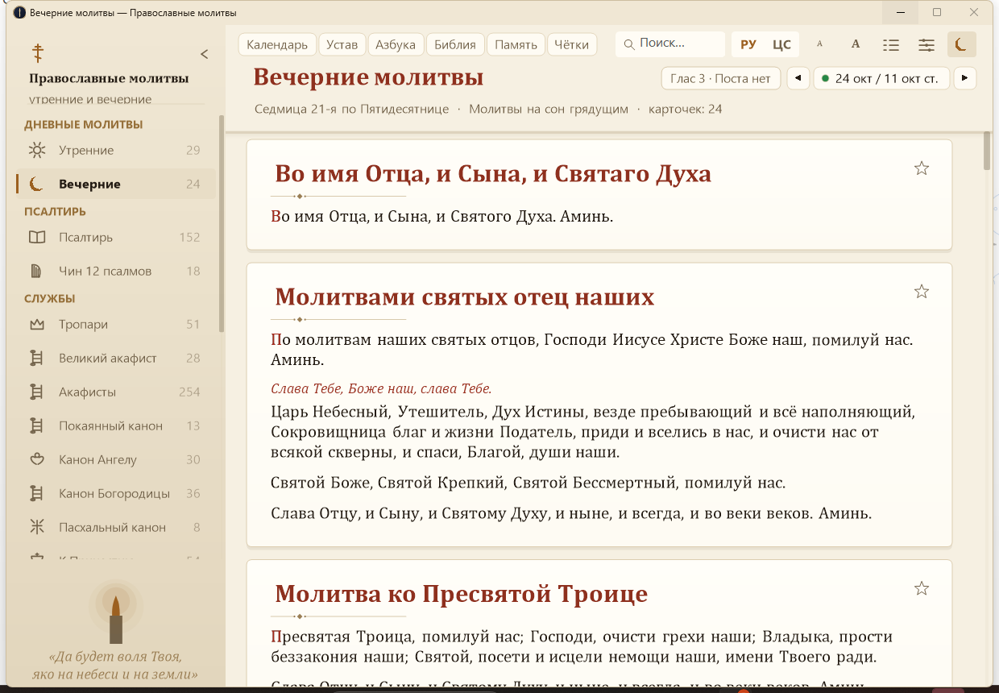
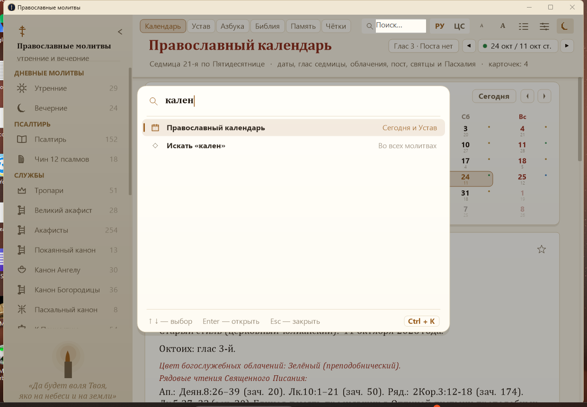
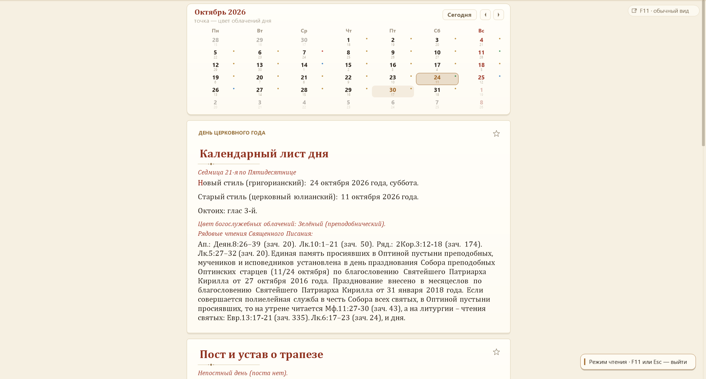

# Православные молитвы

Настольное приложение для Windows с полным набором православных молитв на русском языке:
утренние и вечерние молитвы, Псалтирь по кафизмам, покаянный канон, тропари праздников,
акафист Пресвятой Богородице, молитвы на разные случаи жизни и многое другое.

Написано на C++ (Win32 + GDI+), без сторонних зависимостей: собирается стандартным
компилятором MSVC и запускается как обычная программа.



## Разделы молитв

| Раздел | Содержание |
|---|---|
| **Утренние молитвы** | полное последование: «Во имя Отца, и Сына, и Святаго Духа», молитва мытаря, предначинательная, молитва к Святому Духу, Трисвятое, молитва ко Пресвятой Троице, тропари, Псалом 50, Символ веры, молитвы преподобного Макария Великого и святого Василия Великого, молитва к Ангелу-Хранителю, молитвенное призывание святого, псальмодия Богородицы, тропарь Кресту, молитва о живых и усопших |
| **Вечерние молитвы** | молитвы на сон грядущим: тропари, молитвы преподобного Макария Великого, преподобного Антиоха, святого Иоанна Златоуста, преподобного Иоанникия и Иоанна Дамаскина, исповедание грехов повседневное |
| **Псалтирь** | все псалмы по 20 кафизмам, церковнославянский текст **и** русский перевод, каждый стих с новой строки |
| **Чин 12 псалмов** | кафисма девятая — псалмы, читаемые на утрене (с переводом) |
| **Тропари праздников** | тропари, кондаки и величания на 17 праздников — с церковнославянским текстом с ударениями и переводом (51 молитва) |
| **Акафист Богородице** | великий акафист Пресвятой Богородице — кондаки, икосы и молитвы |
| **Акафисты** | Покрову Богородицы, Воскресению Христову, Иисусу Сладчайшему, всем святым Русским, Божественным Страстям Христовым, новомученикам и исповедникам Церкви Русской, святителю Николаю, на Воздвижение Креста (254 молитвы) |
| **Покаянный канон** | канон ко Господу нашему Иисусу Христу |
| **Канон Ангелу-Хранителю** | канон, читаемый при выходе из дома (30 молитв) |
| **Канон молебный ко Богородице** | канон, поемый во всякой скорби душевной (36 молитв) |
| **Пасхальный канон** | канон на Светлую Пасху, творение преподобного Иоанна Дамаскина |
| **К Святому Причащению** | полное последование ко Святому Причащению (54 молитвы) |
| **Молитвы Богородице** | песни и молитвы Пресвятой Богородице |
| **Молитвы на разные случаи** | благодарение, призывание помощи Духа Святаго, перед выходом из дома, перед и после еды, перед делом, по пути в храм, пред и по чтении Евангелия, перед выходом в интернет, молитва Оптинских старцев, ежечасная молитва Иоасафа Белгородского, молитвенное правило Серафима Саровского, молитвы о детях, молитва Спиридону Тримифунтскому, три молитвы в День Святой Троицы (76 молитв) |
| **Краткие молитвы** | короткие молитвы на каждый день |
| **Часослов** | тропари и молитвы часов |
| **Православный календарь** | на выбранный день: даты по новому и старому стилю, седмица и глас Октоиха, цвет облачений, пост и трапеза, месяцеслов (старый стиль), Пасхалия и ближайшие праздники |
| **Последование богослужения** | полный уставный порядок дня: воскресные тропари и кондаки всех 8 гласов (ЦС с ударениями и перевод), прокимены вечерни, Молимся по часам, вечерня, повечерие и полунощница, утреня с 11 воскресными Евангелиями, часы, литургия (Златоуста / Василия Великого / Преждеосвященных Даров), расписание кафизм Псалтири |
| **Азбука веры и порталы** | онлайн-данные дня с azbyka.ru: богослужебные чтения, полные святцы, тропари и молитвы святым дня, цитата дня, притча, основы православия, практический совет, пролог, день в истории; каталог православных порталов (Православие.Ru, Предание.ру, Оптина пустынь и др.) |
| **Евангелие и Библия** | план «Библия за год» на каждый день (ВЗ, НЗ, Псалтирь, Притчи), молитвы пред и по чтении Евангелия, избранные зачала Евангелия и Апостола на двух языках |
| **Поминальник и сорокоусты** | списки о здравии и о упокоении с датами кончины (авторасчёт 3-го, 9-го, 40-го дня, полугода, годовщин и всех родительских суббот), молитвы о живых и усопших с автоподстановкой имён |
| **Иисусова молитва и чётки** | интерактивные электронные чётки (круги 33/50/100), правило прп. Серафима Саровского, Богородичное правило (15 десятков), наставления отцов |
| **О живых и усопших** | помянник о живых и усопших |
| **Основные молитвы** | Отче наш, Символ веры, Псалом 50, Трисвятое и др. |
| **Избранное** | молитвы, отмеченные звёздочкой |

Всего **21 базовый раздел, 847 молитв, более 5600 абзацев** в двух языках,
плюс 6 вычисляемых/онлайн-разделов календаря и устава.
Разделы «Календарь» и «Устав» вычисляются офлайн на текущую дату (см. ниже).

### Интерфейс

* Четыре цветовые палитры: «Ночная лампада» (тёмно-синяя с золотом),
  «Древний пергамент», «Монастырский камень» и «Светлая лазурь».
* **Быстрые вкладки** «Календарь · Устав · Азбука · Библия · Память · Чётки»
  прямо в шапке — переход одним кликом.
* **Командная палитра** `Ctrl`+`K`: разделы и действия с иконками, живой фильтр,
  подсказки, тонкий индикатор прокрутки, футер и чип `Ctrl`+`K`. Если совпадений
  нет — пункт «Искать «…»» передаёт запрос в основной поиск. Управление:
  `↑`/`↓`, `Enter`, `Esc`.
* **Режим чтения** `F11`: окно занимает рабочую область (панель задач остаётся),
  шапка, меню и поиск скрываются, колонка центрируется. Выход — `F11`, `Esc`
  или плавающая кнопка в правом верхнем углу (на узких экранах — компактная «F11»).
* **Переключатель даты** в шапке: кнопки ◀ ▶ листают дни, клик по плитке даты
  (нов./стар. стиль, с цветной точкой облачения) открывает **миникалендарь-попап**
  — выберите любую дату; горячие клавиши `Alt`+`←` / `Alt`+`→` (день),
  `Alt`+`↑` / `Alt`+`↓` (неделя), `Alt`+`Home` (сегодня).
* **Месячная сетка** в разделе «Календарь»: 6×7 дней, новый и старый стиль,
  цветная точка облачений, выделение выбранного дня, кольцо «сегодня»,
  стрелки по месяцам и кнопка «Сегодня»; клик по дню открывает календарный лист.
* **Электронные чётки**: кольцо прогресса с счётчиком «N из T», номером круга
  и подсказкой; клик по кольцу (или `Enter`) добавляет молитву; справа —
  «до завершения круга» и полоса прогресса.
* **Тосты** внизу окна: появляются с подъёмом, гаснут через несколько секунд,
  ширина подстраивается под текст; не перекрывают управление.
* **Адаптивная шапка**: при сужении окна вкладки и заголовок подбирают размер,
  чтобы все шесть вкладок и полное название раздела оставались видны (минимум
  1120×760) — и с развёрнутым, и со свёрнутым боковым меню; подзаголовок
  сокращается до периода и числа карточек.
* **Тема заголовка окна** (светлая/тёмная) следует выбранной палитре.
* **Справка** `F1` — сгруппированный список горячих клавиш, включая `Ctrl`+`K`
  и `F11`.
* Бейдж «Глас … · Пост/Поста нет» рядом с датой.
* Интерактивные кнопки на карточках: «Открыть на сайте ↗», «Обновить» (azbyka),
  «Изменить списки» (поминальник), счётчик чёток «+1 Молитва / Круг / Сброс».
* Переключатель языка: **РУ** — русский перевод, **ЦС** — церковнославянский текст
  с ударениями. Если перевода нет, показывается оригинал.
* **Содержание** — всплывающая панель со списком молитв раздела, текущая подсвечена,
  по клику происходит плавный переход к молитве. Панель шире (392 px), длинные
  пункты не обрезаются; внизу — кнопка «Случайная молитва».
* **Группированное меню** — разделы сгруппированы («Дневные молитвы», «Псалтирь», «Службы»,
  «Молитвы»); у каждого пункта видно число молитв.
* **Быстрый переход** `Ctrl` + `1…9` — открыть нужный раздел; заголовок окна показывает
  текущий раздел.
* **Индексированный поиск** — поиск идёт по заранее построенному индексу, поэтому
  находит молитву мгновенно даже в полном собрании текстов; регистр не важен,
  в том числе для кириллицы («Псалом» = «псалом»). Кнопка **×** в поле очищает
  запрос и возвращает к разделу; в пустом поле видна подсказка «Поиск молитв…»
  (на узких окнах — «Поиск…»).
* **Настройки чтения** — шрифт (Cambria, Georgia, Constantia, Times, Palatino),
  межстрочный интервал, ширина колонки, оформление и палитра. Панель шире
  (384 px): все чипы, включая «Поминальник…», видны без обрезки.
* Поиск по всем разделам сразу; найденные слова подсвечиваются в тексте.
* Правая кнопка мыши на молитве: копирование (в том числе без знаков ударения),
  сохранение в файл, печать, добавить в избранное.
* **Полоса прокрутки** с перетаскиваемым ползунком, переходом по дорожке и
  подсветкой при наведении; кнопка «вверх» появляется при глубокой прокрутке.
* Сворачиваемая боковая панель (кнопка в углу или `Ctrl` + `B`).
* **Меню прокручивается**: колесо мыши над панелью, перетаскивание ползунка
  справа или щелчок по дорожке; в свёрнутом виде — по значкам разделов.
* Подсказки к кнопкам, подсветка карточки под курсором, полоса прогресса чтения.
* Положение прокрутки запоминается для каждого раздела — при возвращении чтение
  продолжается с того же места.
* Все настройки (тема, язык, шрифт, интервал, ширина колонки, состояние меню,
  последний раздел, позиции прокрутки, избранное) хранятся в
  `%APPDATA%\OrthodoxPrayers\settings.ini` и автосохраняются каждые 10 секунд.





### Горячие клавиши

| Клавиши | Действие |
|---|---|
| `Ctrl` + `F` | перейти к поиску |
| `Ctrl` + `K` | командная палитра |
| `F11` | режим чтения (выйти — `F11` / `Esc`) |
| `Esc` | закрыть палитру/режим чтения/панель, очистить поиск |
| `Ctrl` + `C` | копировать выделенный текст |
| `Ctrl` + `Shift` + `C` | копировать молитву целиком |
| `Ctrl` + `A` | выделить всё |
| `Ctrl` + `+` / `Ctrl` + `-` | размер шрифта |
| `Ctrl` + `PgDn` / `Ctrl` + `PgUp` | переход к следующей / предыдущей молитве |
| `Ctrl` + `B` | свернуть / развернуть боковое меню |
| `Ctrl` + `1`…`9` | переход к разделу молитв |
| `Alt` + `←` / `→` | предыдущий / следующий день (календарь) |
| `Alt` + `↑` / `↓` | предыдущая / следующая седмица (±7 дней) |
| `Alt` + `Home` | сегодняшняя дата |
| `F1` | справка по горячим клавишам |
| `Shift` + `F10` | меню молитвы |
| `Пробел` | пролистнуть вниз |
| `Enter` | +1 молитва (в разделе «Чётки») |

## Сборка

Требуется Visual Studio 2019/2022 (или новее) с компонентом
«Разработка классических приложений на C++».

```bat
build.bat
```

Скрипт сам находит Visual Studio, подготавливает окружение MSVC x64 и собирает
`build\OrthodoxPrayers.exe`. То же самое вручную:

```bat
powershell -ExecutionPolicy Bypass -File build.ps1
```

Приложение не требует установки и каких-либо внешних библиотек.

## Обновление текстов

Тексты молитв получены с [azbyka.ru](https://azbyka.ru/) и хранятся в виде сгенерированного
C++-файла `src/prayers_data.cpp`. Чтобы обновить их:

```bat
python tools\fetch_prayers.py   :: загрузка страниц  -> data/blocks.json
python tools\fetch_troparia_cs.py :: ЦС с ударениями -> data/troparia_cs.json
python tools\build_data.py      :: разбор на молитвы  -> data/prayers.json
python tools\gen_cpp.py         :: генерация кода   -> src/prayers_data.cpp
build.bat
```

`tools/fetch_prayers.py --only troparia` обновляет только один раздел, не трогая остальные.

Церковнославянские тексты тропарей, кондаков и величаний берутся со страниц
`azbyka.ru/days/<дата>` и `azbyka.ru/velichanie` — там они набраны **с ударениями**
(`data/troparia_cs.json`). Старинный молитвенник даёт русские переводы, они сохраняются;
если перевода в молитвеннике нет, берётся перевод azbyka. Праздники перечислены
в порядке церковного года (с сентября), «Покров» добавлен из azbyka.

Скрипт `tools/audit_prayers.py` проверяет получившиеся тексты и сообщает о подозрительных
местах (латиница в кириллице, обрывы, отсутствие перевода, дубли).

При разборе автоматически исправляются дефекты источника:
- латинские омоглифы в русских словах (`eго́` → `его́`, `Теоdорет` → `Теодорет`);
- разрывы слов вёрсткой (`П оми́луй` → `Поми́луй`, `Ж ите́йское` → `Жите́йское`);
- номера сносок, знаки «*», служебные пометки сайта («Видеоноты…», «См. также…»);
- косые черты в стихах → переносы строк, длинные тексты → отдельные стихи;
- обращения к императору в тропарях → к «Государю» (исторические тексты не трогаются).

## Структура проекта

```
src/
  app.cpp           интерфейс: отрисовка, разметка текста, ввод, настройки
  calendar.h        модуль календаря: точка входа
  calendar_dates.*  JDN-математика, юлианская пасхалия, месяцеслов
  calendar_day.*    седмицы, гласы Октоиха, посты, цвет облачений
  calendar_kalendar.cpp   раздел «Православный календарь»
  calendar_sluzhby*.cpp   раздел «Последование богослужения»
  calendar_azbyka.cpp     раздел «Азбука веры и порталы» (онлайн + ссылки)
  bible_section.cpp       разделы «Евангелие и Библия» и «Чётки»
  pominalnik.*            поминальник: списки, молитвы, дни памяти
  pominalnik_dialog.cpp   редактор списков (модальный диалог)
  online.*                загрузка и разбор azbyka.ru/days (WinHTTP + кэш)
  theme.h           цветовые темы, орнаментика и векторные иконки
  prayers.h         структуры данных молитв
  prayers_data.cpp  сгенерированные тексты молитв
  app.manifest      манифест (Common Controls v6, DPI-awareness)
tools/              скрипты загрузки и обработки текстов, автотесты интерфейса
data/               промежуточные данные (JSON)
build/              собранное приложение и скриншоты
```

### Православный календарь и последование (офлайн)

Разделы «Православный календарь» и «Богослужение сегодня» вычисляются при
запуске без всякой сети:

* переход на старый стиль (юлианский календарь) через юлианские дни (JDN);
* юлианская (александрийская) пасхалия; от неё — Вербное, Вознесение,
  Троица, начало Триоди и Великого поста;
* глас Октоиха: цикл привязан к Фоминой неделе (глас 1), повторяется каждые
  8 седмиц; на Светлой седмице и Пятидесятнице глас не воспевается;
* седмицы: именные (Триодь), по Пасхе (2–7), по Пятидесятнице (сквозная
  нумерация), постные;
* пост: четыре многодневных поста, среды и пятницы, сплошные седмицы,
  послабления в праздники; пять уровней трапезы;
* месяцеслов — сокращённый перечень общецерковных праздников по старому
  стилю; последование дня — по общему чину устава (без минейных подробностей
  и зачал; это честно оговорено в самом разделе).

### Выбор даты (мини-календарь)

Клик по плитке даты открывает собственный мини-календарь на GDI+ (не системный
`MonthCal`: на этой системе он после `MCM_SETCURSEL` теряет согласованность карты
попаданий). Календарь открывается на месяце просматриваемой даты, листается
стрелками, выделяет выбранный день и «сегодня», по клику на день выбирает его
(в том числе дни соседних месяцев), футер «Сегодня» возвращает к текущей дате.
Выбор даты устанавливает смещение **абсолютно** от сегодняшнего дня. Закрывается
кликом мимо попапа, повторным кликом по плитке, по `Esc`, при переключении
в другое окно; при перетаскивании главного окна следует за плиткой.

### Месячная сетка в разделе «Календарь»

Под заголовком карточки — сетка 6×7 на выбранный месяц: дни нового стиля
крупно, старого — мелко, цветная точка облачений, выделение выбранного дня и
кольцо вокруг «сегодня». Стрелки листают месяцы, кнопка «Сегодня» возвращает
к текущей дате. Клик по дню выбирает его и перестраивает календарный лист;
дни соседних месяцев тоже доступны. Сетка кэшируется на 42 дня и следует за
сменой даты из шапки.

### Азбука веры: онлайн-дополнение

Раздел «Азбука веры и порталы» загружает страницу дня `azbyka.ru/days/ГГГГ-ММ-ДД`
(WinHTTP в фоновом потоке, интерфейс не блокируется) и разбирает рубрики:
чтения дня, полные святцы, тропари/кондаки/молитвы святым дня с церковнославянским
текстом и переводом, цитата дня, притча, основы православия, практический совет,
пролог в поучениях, «этот день в истории». Загруженная страница кэшируется в
`%APPDATA%\OrthodoxPrayers\day_ГГГГ-ММ-ДД.html`, при последующих запусках день
читается из кэша; обновить можно кнопкой «Обновить» на карточке. Раздел также
предлагает уставные тропари 8 гласов Октоиха в карточках «Последования
богослужения» и переходные ссылки на полный текст богослужения дня,
богослужебные указания и крупные православные порталы. Кнопка «Открыть на сайте ↗» есть у каждой карточки с адресом.

### Поминальник и чётки

* Списки «о здравии» и «о упокоении» редактируются модальным диалогом
  (кнопка «Изменить списки» или пункт меню карточки); хранятся в settings.ini.
  Формат усопших: `Имя (дд.мм.гггг)` — приложение само считает 3-й, 9-й и 40-й
  день, полгода, годовщины, Радоницу, мясопустную и Троицкую родительские
  субботы, Димитриевскую субботу и 9 мая.
* Молитвы о живых и об усопших подставляют имена из списков автоматически.
* Электронные чётки: кнопка «+1 Молитва» (или Enter в разделе), круги
  33 / 50 / 100, сброс; Богородичное правило на 15 десятков и правило прп. Серафима.
  Счёт молитв и выбранный круг сохраняются в settings.ini — при запуске чётки
  восстанавливаются (ключи `chetki_count`, `chetki_target`).
* Кольцо прогресса в первой карточке чёток показывает «N из T», номер круга и
  подсказку; клик по кольцу добавляет молитву. Справа (на широких окнах) —
  «до завершения круга», число оставшихся молитв и полоса прогресса.

Проверка формул против календарей azbyka.ru (2026 г.): сыропустная неделя —
глас 4, мясопустная — глас 3, Торжество Православия — глас 5, Вербное —
глас 2, 23 октября — седмица 21-я, глас 3. Регресс-проверка «чистоты» текста
календаря: `python tools\check_calendar.py`.

Автотесты интерфейса (PowerShell): `tools\settings_test.ps1` (кликабельность панелей),
`tools\scrollbar_test.ps1` (перетаскивание ползунка), `tools\sidebar_test.ps1` (прокрутка меню),
`tools\psaltir_test.ps1` (Псалтирь в обоих языках), `tools\new_sections_test.ps1` (новые разделы),
`tools\troparia_test.ps1` (тропари в обоих языках), `tools\stress_test.ps1`
(проверка всех элементов управления), `tools\datepick_real.ps1` (выбор даты в миникалендаре
реальным кликом), `tools\datepick_offset_test.ps1` (повторный выбор после смещения —
защита от двойного учёта), `tools\popup_nav_test.ps1` (навигация по месяцам, футер
«Сегодня», закрытие кликом мимо), `tools\popup_behavior_test.ps1` (toggle, Esc,
следование попапа за окном), `tools\popup_visual.ps1` (скриншоты миникалендаря),
`tools\calgrid_test.ps1` (месячная сетка: выбор дня, стрелки, «Сегодня»),
`tools\ring_toast_test.ps1` (кольцо чёток, тост, панель настроек),
`tools\command_palette_test.ps1` (командная палитра `Ctrl`+`K`, пункт
«Искать «…»», режим чтения `F11`, очистка поиска, панели при 1120),
`tools\palette_test.ps1` (все четыре палитры: шапка окна, сетка, чётки, настройки).

## Источник текстов

Молитвы, Псалтирь, каноны, акафист и тропари приведены по материалам молитвослова
[azbyka.ru](https://azbyka.ru/) (церковнославянский текст и русский перевод).
